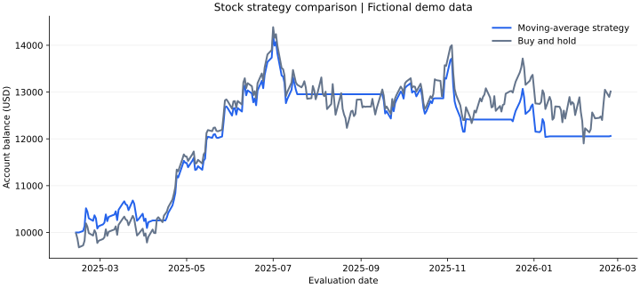

# Stock Strategy Backtest

A Python finance project that compares a moving-average trading strategy with buy-and-hold, including transaction fees and daily drawdown.

**Tools:** Python · CSV · moving averages · performance analysis  
**Run:** Python 3.9+ or Thonny; no extra packages required.



## Demo results

These are reproducible results from **fictional prices**, not historical stock performance or evidence of investment returns.

| Metric | Result |
| --- | ---: |
| Starting capital | $10,000.00 |
| Strategy final balance | $12,061.94 |
| Strategy return after fees | 20.62% |
| Buy-and-hold final balance | $13,013.09 |
| Buy-and-hold return after fees | 30.13% |
| Strategy maximum daily drawdown | 15.31% |
| Transactions, including final liquidation | 12 |
| Evaluation period | February 12, 2025–February 24, 2026 |

In this demo, buy-and-hold outperformed the strategy by 9.51 percentage points. A trading rule can lag a rising market; generating signals alone does not establish that a strategy is profitable on real data.

## Run the project

1. Download `stock_strategy_backtest.py` and open it in Thonny.
2. Click **Run**, then press **Enter** at the prompt to use the demo.
3. Read the console results and open the generated CSV files.

From a terminal:

```bash
python3 stock_strategy_backtest.py
```

For your own data, enter the path to a CSV with `Date,Open,Close` headers. Dates must use `YYYY-MM-DD`; prices must be positive. Supply at least 31 rows for the default windows. Include enough earlier data for the 30-session warm-up, then check the reported evaluation dates. Use consistently split-adjusted opening and closing prices for one stock. The program does not download prices.

## How it works

- Calculates 10-session and 30-session simple moving averages from prior closing prices.
- Buys at the next session's opening price when the fast average is above the slow average; sells when it is equal or below.
- Holds cash while out of the market; uses the full balance and allows fractional shares when invested.
- Charges 0.1% of transaction value for purchases and sales.
- Starts both strategies after the same warm-up and liquidates at the final close.
- Calculates maximum drawdown from daily closing balances, including the starting balance and final liquidation fee.

## Files and outputs

| File | Purpose |
| --- | --- |
| `stock_strategy_backtest.py` | Complete runnable program |
| `demo_equity.svg` | Preview of the included demo run |
| `backtest_results.csv` | Daily prices, moving averages, and account balances |
| `trade_log.csv` | Transaction dates, prices, shares, and fees |

Running the demo also creates `demo_prices.csv`. Running again replaces the generated CSV outputs in the script's folder.

## Scope and limitations

This is an educational, single-stock, long-or-cash model. It excludes dividends, taxes, spread, slippage, and interest on cash, and assumes fills at opening prices. Demo weekdays do not model exchange holidays. Results are sensitive to the dataset, date range, and moving-average windows. There is no out-of-sample validation or evidence here that the strategy generalizes.

## AI assistance

ChatGPT assisted with code generation, debugging, and documentation. The project makes its timing, fee assumptions, and sample data explicit so its calculations can be inspected and reproduced.
